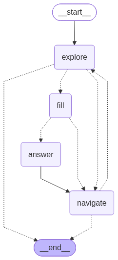

# Job Application Agent

**A multi-agent LLM system that fills out job applications in your own browser, grounded in
your profile, running on a local model, and always stopping before Submit.**

It reads the posting, moves through the application one safe click at a time, fills every field
it can answer from a structured profile, and drafts answers to open-ended questions from your
real experience. Then it hands the tab back to you: a human always reviews the form and clicks
the final button. It runs on a local LLM, so your profile never has to leave your machine.


---

## Highlights

- **Agents that make decisions, not just extract.** Every step is a judgment on an unstructured
  page: what kind of page this is, which single control is safe to press, which profile fact
  answers a question worded differently on every site ("Work eligibility", "Right to work?",
  "Are you legally authorized…"), and when to abstain instead of answering.
- **Multi-agent orchestration.** A [LangGraph](https://github.com/langchain-ai/langgraph) state
  machine routes between four specialist agents based on what they report. A state reducer
  carries context across pages, and every loop is bounded: 40 graph steps and a per-tab timeout.
- **One system for every applicant tracking system.** Workday, Greenhouse, Ashby and the rest
  are handled by the same prompts and the same guards. The graph and the agents contain no
  per-site code.
- **Grounded, abstain-first generation.** Answers come only from your profile and the job
  description. A question the evidence doesn't support is left blank and flagged
  (`confident=false`) for you, rather than filled with something plausible.
- **Guardrails in code, not only in prompts.** Middleware refuses repeated actions and limits
  file access to your resumes; your password never enters the model's context; the graph ends
  at the submit page.
- **Measured model selection.** A reproducible benchmark ([`eval/`](eval/)) picked the slower
  dense model: it was the only one that never broke the Navigator, so it finished the tasks
  about 3.5× faster end to end than models with 2.5–3× its token speed.

## How it works

<p align="center">
  
  <br>
  <sub>Generated from the compiled graph by <code>scripts/draw_graph.py</code>. Dotted edges are conditional.</sub>
</p>

You open a few postings in a Chromium-based browser. `run.py` works through them one tab at a
time, and on each tab the graph above routes between four agents. Each agent sees the page
through the [Playwright MCP server](https://github.com/microsoft/playwright-mcp), which exposes
the page's accessibility tree and actions such as click, type and select.

| From | To | When |
|---|---|---|
| explore | navigate | a job page, a login page, a redirect, or an open dialog |
| explore | fill | an application form |
| explore | end | the submit page (your turn), or an irrelevant or unreadable page |
| navigate | explore | it clicked: re-read the new page |
| navigate | end | no safe step forward |
| fill | answer | open-ended questions were found |
| fill | navigate | nothing left to answer |
| answer | navigate | always |

| Agent | Role | Browser tools | Reports |
|---|---|---|---|
| **Explorer** | Classifies the page and extracts the job title, company, description and requirements | snapshot, find, wait | `page_type`, `has_fields`, `dialog`, `requires_resume_upload`, job details |
| **Navigator** | Takes exactly one safe step forward (*Apply*, *Next*, *Continue*), or logs in to an existing account | snapshot, find, wait, click, type | `clicked` or `no_action`, and the target |
| **Form Filler** | Fills fields from your profile only; skips anything uncertain | snapshot, find, wait, click, type, fill form, select, press key, upload | Filled, skipped, and open questions |
| **Answer Writer** | Writes answers to open-ended questions, grounded in the job description and your profile | snapshot, find, wait, type, fill form | Answered (with confidence) and unanswered |

Each agent is a LangChain `create_agent` with its own system prompt, a strict Pydantic
`response_format`, and only the browser tools its job needs.

## Built with

| Layer | Technology | What it does here |
|---|---|---|
| Orchestration | LangGraph 1.2 | State machine, conditional routing, state reducer, step limit |
| Agents | LangChain 1.3 `create_agent` | Tool-calling agents with structured reports |
| Guardrails | LangChain middleware | Logging, repeat blocking, file allowlist, context trimming |
| Schemas | Pydantic 2 | Every agent report is validated before the graph uses it |
| Browser | Playwright MCP 0.0.83 over CDP | Accessibility-tree snapshots and actions in your own browser |
| Model | llama.cpp `llama-server` | Local inference over the OpenAI-compatible API |
| Runtime | Python 3.14, asyncio | One MCP session, tabs processed in sequence, per-tab timeout |
| Tracing | LangSmith (optional) | Off by default |

## Engineering decisions

- **It never submits.** Submit, Confirm, Finalize, Withdraw and Delete are on the Navigator's
  forbidden list, and when the Explorer classifies the submit page, the graph ends there and
  reports `submit_page`. The final click is yours.
- **Copy where possible, generate only where needed.** The Form Filler copies values from the
  profile and never rephrases them. Only the Answer Writer writes prose, so only it runs with
  thinking on and a temperature of 0.3; the other three run with thinking off at temperature 0.
- **One step at a time.** The Navigator is told to make at most one click per turn, and the
  Explorer re-reads the page after every click, so each decision is made on the page as it is.
- **Your password never reaches the model.** The Navigator types the placeholder
  `LOGIN_PASSWORD`. The MCP server swaps in the real value from `.env.secrets` and redacts it
  from everything it returns.
- **Context survives page changes.** A reducer merges the Explorer's reports, so the job
  description read on page one is still there when the Answer Writer needs it on page four.
- **One MCP session per run.** Element refs (`e48`) only live in the MCP process that took the
  snapshot, so the whole run shares one session and moves it between tabs.
- **Trimming that keeps the prompt cache.** Long forms grow the Form Filler's context past
  75k tokens. Old tool results are then cleared **10 at a time** rather than one per call, so
  the prompt's prefix stays identical between clears and llama.cpp can reuse its cache. In a
  simulation of a long fill, that took cache hits from 0% to 89%.
- **Sites that forbid automation are skipped.** LinkedIn is on the skip list, so tabs open on
  it are never processed.

## Evaluation: choosing a model

The agents need a model that calls tools reliably: it must pass the right element ref, take one
step at a time, and return its report as a tool call. Three models that fit a 24 GB GPU ran the
same five tasks (explore, navigate, fill, explore, navigate), 5 times each, on a local practice
site with this project's own agents and prompts. Measured 2026-10-22 on a Radeon 7900 XTX,
llama.cpp b9544, temperature 0:

| Model | Architecture | Tasks passed (of 25) |
|---|---|---|
| **Qwen3.8-27B** | dense | **25** |
| Qwen3.6-35B-A3B | mixture of experts, ~3B active | 16 ¹ |
| Gemma-4-26B-A4B | mixture of experts, ~4B active | 12 |

A task passes only if the page itself shows the goal was reached (checked in the browser, not
taken from the model's report), the agent delivered its structured report, and no request hung.
Ticking the form's privacy checkbox isn't scored.

¹ One of these is a navigation where the click worked but the report said `no_action`, which
would end the tab in the real graph; 15 is the stricter reading.

**Use Qwen3.8-27B.** The two mixture-of-experts models write tokens 2.5–3× faster and do well
as Explorers and fillers. As Navigators, though, they passed labels or whole snapshot lines
instead of element refs, clicked twice in one step, reported clicks that never happened, and
hung by writing their answer as text instead of the report. Qwen3.8 finished all 25 tasks in
281 s; the others needed 951 s and 1,016 s. Gemma did no better at a higher-precision
quantization, so the failures come from the model, not the quantization.

Reproduce it with whichever model your server has loaded:

```bash
python -m http.server 8765 --directory eval/site &
# a throwaway headless browser, separate from yours
brave-browser --headless=new --remote-debugging-port=9333 --user-data-dir=/tmp/bakeoff-profile &
PROFILE_FILE=profile.example.yaml BROWSER_URL=http://localhost:9333 python eval/bakeoff.py 5 <label>
```

Method, per-task results, failure examples, and the guards a fast model would need are in
[docs/model-comparison.md](docs/model-comparison.md).

## Quick start

**Requirements**

- **Python** 3.14 (developed on 3.14.7)
- **Node.js** on `PATH`: it runs the Playwright MCP server, which the first run downloads
  through `npx`
- **A Chromium-based browser** (Chrome, Brave, …) started with `--remote-debugging-port`
- **An LLM endpoint.** Tested with llama.cpp `llama-server` (recommended: Qwen3.8-27B). Other
  OpenAI-compatible servers (vLLM, LM Studio, Ollama) should work if they accept or ignore
  llama.cpp's `chat_template_kwargs` field. Hosted APIs (OpenAI, Anthropic) need a small change:
  one client factory in `settings.py`.

**1. Install**

```bash
git clone https://github.com/andreyrmacedo/job-application-agent.git
cd job-application-agent
python3.14 -m venv .venv && source .venv/bin/activate
pip install -r requirements.txt
```

**2. Configure**

```bash
cp .env.example .env                                   # LLM endpoint, login e-mail
cp config/profile.example.yaml config/profile.yaml     # who you are
echo 'LOGIN_PASSWORD=your-job-site-password' > .env.secrets
mkdir -p resume && cp /path/to/your-resume.pdf resume/resume.pdf
```

Edit `config/profile.yaml` with your own details. It, `.env`, `.env.secrets` and `resume/` are
all gitignored.

**3. Start the browser** with remote debugging and a dedicated profile:

```bash
brave-browser --remote-debugging-port=9222 --user-data-dir="$HOME/.brave-agent"
# or: google-chrome --remote-debugging-port=9222 --user-data-dir="$HOME/.chrome-agent"
```

To keep using your computer while it runs, see [docs/browser-setup.md](docs/browser-setup.md):
it covers running the browser on another workspace, and an optional MCP patch that stops it
pulling focus.

**4. Open a few job postings** in that browser, one per tab.

**5. Run**

```bash
python run.py                  # every open posting, 25-minute cap per tab
python run.py --timeout 600    # a tighter cap
```

Every browser action is printed as it happens. At the end you get a summary (example output):

```text
===== SUMMARY =====
submit_page          262s https://boards.greenhouse.io/example/jobs/123
login                 43s https://example.wd5.myworkdayjobs.com/...
timeout             1500s https://example.wd5.myworkdayjobs.com/...
```

| Status | Meaning |
|---|---|
| `submit_page` | Filled through to the final page. Review it and submit it yourself. |
| `ready_to_fill`, `analyzed` | Stopped mid-flow (no safe next step). Finish it by hand. |
| `login` | Needs an account. Create one yourself; the next run will log in. |
| `tab_not_found` | The tab was closed before its turn. |
| `timeout` | Hit the per-tab cap. |
| `irrelevant`, `blocked` | Not an application page, or the Explorer couldn't tell. |
| `error: GraphRecursionError` | More than 40 graph steps: usually a page that didn't advance. Finish it by hand. |
| `error: <Type>` | Any other exception ended the tab; the log above it shows where. |

Every tab except `tab_not_found` is also recorded as soon as it ends, so an interrupted run keeps
the tabs it finished. A tab that times out or errors keeps what the agents had read.

| File | One entry per tab |
|---|---|
| `data/applications.csv` | `timestamp`, `company`, `title`, `url`, `status`, `seconds`, `salary_min`, `salary_max`, `salary_currency`, `model`, `trace_id` |
| `data/applications.jsonl` | The same, plus `requirements` and `job_description`, since postings often go offline |

`trace_id` is the run's LangSmith trace, blank when tracing is off. Nothing from your profile is
written, and `data/` is gitignored.

## Configuration

| File | What it holds |
|---|---|
| `config/profile.yaml` | **You:** contact details, work authorization, work history, education, skills, screening answers, salary rules, EEO preferences. The only source the agents may answer from. Start from `profile.example.yaml`. |
| `.env` | **The machine:** `LLM_BASE_URL`, `LLM_MODEL`, `LLM_API_KEY`, `BROWSER_URL`, plus `LOGIN_EMAIL`, `PROFILE_FILE` and optional LangSmith tracing. Empty values fall back to the defaults in `settings.py`. |
| `.env.secrets` | `LOGIN_PASSWORD`. Read only by the MCP server, never by the model. |
| `resume/resume.pdf` | **Your resume**, for upload fields. Point `resumes.default` in the profile at another file if you like; only the files listed there can be uploaded. |

> **Tracing.** LangSmith traces include your profile and the pages visited. `.env.example`
> ships with `LANGSMITH_TRACING=false`; turn it on only if you're fine with that.

## Project layout

```text
run.py                  entry point: MCP session, tab loop, timeout, summary, tracker
graph/
  state.py              graph state, the Explorer reducer, page type -> status
  nodes.py              one node per agent
  routing.py            the conditional edges
  build.py              build_graph(): nodes, middleware and edges
agents/                 one file per agent: system prompt, output schema, tool list, factory
  explorer.py  navigator.py  form_filler.py  answer_writer.py
browser_tools.py        Playwright MCP client and tab helpers
settings.py             LLM clients, middleware, loaded profile
config/                 profile.example.yaml
eval/                   model benchmark: bakeoff.py, the practice site, results
tests/                  unit tests for routing, the reducer, salary, tabs, trimming (no LLM or browser)
scripts/
  draw_graph.py         renders docs/images/graph.png from the compiled graph
  patch_mcp.sh          optional: a pinned Playwright MCP that doesn't steal focus
docs/                   browser setup, model comparison, images
```

To add an agent: write `agents/<name>.py` (prompt, Pydantic output model, tool list, factory),
add a node factory in `graph/nodes.py`, and wire its edges in `graph/build.py`.

## Roadmap

This is an active personal project. Next up:

- **Workday "My Experience" pages.** Repeating sections and search-as-you-type fields (school,
  field of study, skills) are slow and can hit the per-tab cap.
- **Skip finished postings.** The tracker already records each tab's status. Next, a run skips
  postings that already reached `submit_page`.
- **Evaluation scope.** The benchmark is one practice site with 5 runs per task, and it doesn't
  cover the Answer Writer. Next: a fixed set of saved real forms with expected values, so a
  prompt or model change can be measured before it ships.

## Responsible use

You are responsible for every application sent under your name. Review each form before
submitting, respect each site's terms of service, and don't use the agent to mass-apply to roles
you haven't read.

## License

[MIT](LICENSE)
